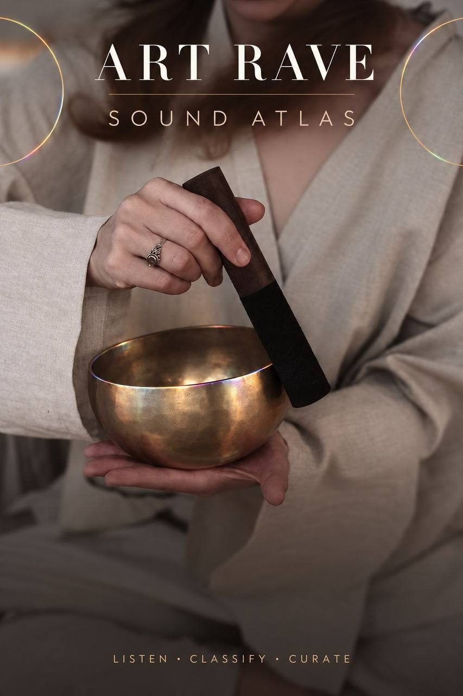
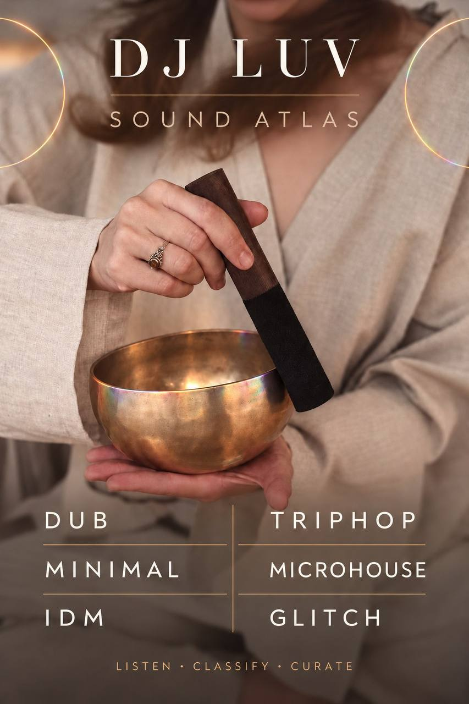

# ArtRave / Sound Atlas

Два связанных направления Снежаны: исследование арт-рэйва как формы современного шоу и учебный маршрут по истории электронного звука. Это работы разных лет, представленные рядом, а не одна дипломная публикация.

**Быстрый вход:** [посмотреть Sound Atlas](atlas/sound-atlas-2026.pdf) → [открыть код сборки](atlas/build_sound_atlas.js) → **статус:** презентация и текст диплома опубликованы → **дальше:** проверить даты, библиографию и связи жанров.

## Начать здесь

1. [Sound Atlas — 17-страничная PDF-презентация](atlas/sound-atlas-2026.pdf) (2026): маршрут для чтения и слушания от электроакустических экспериментов к танцевальным сценам.
2. [«Арт-рэйв как инновационная форма современного шоу» — основной текст дипломной работы](thesis/art-rave-2020-text.md) (2020): история рейва, развитие сцен по странам и авторские выводы.
3. [Как устроен Sound Atlas](atlas/dj-luv-sound-atlas.md) и [единый маршрут](atlas/dj-luv-unified-sound-atlas.md) — дополнительные рабочие заметки.

### DJ LUV / Sound Atlas

[Музыкальные направления и эпохи](atlas/genres-and-eras/README.md) — рабочая папка для шести направлений с карточки и дальнейшего исследования их истории.

[Как превратить атлас в учебный вклад](atlas/LEARNING-CONTRIBUTION.md) — один цикл: слушать → наблюдать → сверять источник → предложить точечную правку.

[Первая страница PDF](atlas/sound-atlas-cover.png) сохранена отдельно. Главная обложка ArtRave остаётся первой на странице; карточка DJ LUV представляет раздел Sound Atlas.

## Исходники и границы публикации

[Код сборки Sound Atlas](atlas/build_sound_atlas.js) написан на JavaScript с PDFKit. Для пересборки: `npm install` → `npm run build:atlas`. В репозитории нет аудиозаписей и чужих обложек.

Диплом опубликован **в текстовой версии**: основной текст и список источников сохранены; титульные служебные данные и приложения с фотографиями из исходного DOCX не перенесены в открытый доступ. Оригинальный файл содержит изображения третьих лиц и остаётся вне репозитория. Исторические утверждения диплома относятся к версии 2020 года; Sound Atlas — отдельный учебный материал 2026 года. [Код сборки доступен по MIT](CODE-LICENSE.md); лицензия не распространяется на текст и изображения.

## Что дальше

Сверить библиографию и спорные даты, подписать тип связей между жанрами и проверить маршрут на слушателях. Для публикации фото-приложений диплома понадобятся отдельные права на изображения.
